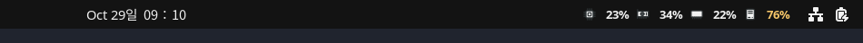

# juno_tools

Ubuntu에서 사용하는 작은 도구 모음입니다.

## Juno System Monitor

Ubuntu 상단 패널의 **날짜/시계와 오른쪽 시스템 아이콘 사이**에 CPU, GPU, 메모리, 저장장치 상태를 표시하는 GNOME Shell 확장입니다.



[밝은 테마의 상세 메뉴](docs/menu.png) · [어두운 테마의 상세 메뉴](docs/menu-dark.png) · [설정 화면](docs/settings.png)

상단에는 CPU 칩, GPU 보드, 메모리 모듈, SSD를 나타내는 **아이콘과 사용률**만 표시합니다. 항목 이름 대신 아이콘을 사용하고 간격을 줄여 패널 공간을 아꼈습니다. 스크린 리더에는 각 항목의 이름과 현재 수치를 제공합니다.

클릭 메뉴는 **CPU·GPU·Memory·Storage 네 구역**으로 구성합니다. 각 구역에서 사용률을 먼저 보여주고, 아래에 온도나 용량 등의 보조 정보를 모아 표시합니다. 긴 GPU 이름은 말줄임 처리합니다. 메뉴 글자와 아이콘은 GNOME 테마의 전경색을 따라 밝은 테마와 어두운 테마에 맞게 표시됩니다.

지원 환경: **Ubuntu 24.04 / GNOME Shell 46**, X11 및 Wayland. 실제 동작 검증은 GNOME 46에서 수행했습니다. 다른 GNOME 버전은 호환성을 확인한 뒤 추가할 예정입니다.

| 항목 | 상단 패널 | 클릭 메뉴 |
| --- | --- | --- |
| CPU 칩 아이콘 | 전체 CPU 사용률 | 사용률, CPU 센서의 최고 온도 |
| GPU 보드 아이콘 | 선택한 GPU의 사용률 | GPU 이름, VRAM 사용량, 온도 |
| 메모리 모듈 아이콘 | 실제 사용 중인 RAM 비율 | 사용량/전체 용량, 스왑 |
| SSD 아이콘 | 선택 경로가 속한 파일시스템의 용량 사용률 | 사용량/전체 용량, 여유 공간, 읽기·쓰기 속도, I/O 활동률 |

사용률 75% 이상은 노란색, 90% 이상은 빨간색으로 표시합니다. 첫 CPU/I/O 샘플과 지원하지 않는 센서는 `—`로 표시합니다. CPU 온도는 현재 Intel `coretemp`, AMD `k10temp`/`zenpower`, `cpu_thermal` hwmon 센서를 읽습니다.

### 설치

기본 Ubuntu GNOME 환경에서 관리자 권한 없이 설치합니다.

```bash
git clone https://github.com/YooJuno/juno_tools.git
cd juno_tools
bash gnome-system-monitor/install.sh --enable
```

`--enable`은 이 확장의 활성화 상태를 저장하고, 사용자 확장 전체가 꺼져 있으면 함께 켭니다. 다른 확장의 개별 활성화/비활성화 목록은 유지합니다.

처음 설치한 확장을 GNOME이 아직 인식하지 못하면 **로그아웃 후 다시 로그인**하세요. 활성화 설정이 저장되어 있으므로 자동으로 표시됩니다. 이후 재부팅할 때도 우분투에 로그인하면 자동으로 시작합니다. 업데이트도 설치 스크립트를 다시 실행한 뒤 로그아웃/로그인하면 새 코드가 로드됩니다.

`--enable` 없이 설치한 경우에는 로그아웃/로그인 후 직접 활성화합니다.

```bash
gnome-extensions enable system-monitor@juno-tools
```

`--enable` 없이 설치했고 확장이 전체적으로 꺼져 있으면 Extensions 앱에서 확장 사용도 켜야 합니다. 필요한 명령이 없는 최소 설치 환경에서는 `gnome-shell`, `gjs`, `libglib2.0-bin` 패키지가 필요합니다.

ZIP으로 설치하려면 아래의 패키징 명령으로 ZIP을 생성한 뒤 설치합니다.

```bash
bash gnome-system-monitor/pack.sh
gnome-extensions install --force dist/system-monitor@juno-tools.shell-extension.zip
```

이후 처음 설치한 경우 로그아웃/로그인하고 위의 enable 명령을 실행하세요.

### 설정

상단 표시를 클릭한 뒤 **Settings…**를 선택하거나 아래 명령을 실행합니다.

```bash
gnome-extensions prefs system-monitor@juno-tools
```

- 갱신 주기: 기본 2초, 1~30초.
- CPU/GPU/MEM/SSD 표시를 개별적으로 켜고 끌 수 있습니다. 모두 끄면 설정 메뉴에 접근할 수 있도록 CPU 표시를 남깁니다.
- 저장 경로: 기본 `/`. `/home`, `/mnt/data` 등 실제 경로를 입력하고 적용 버튼을 누릅니다. 별도 파티션이 아니라면 `/`와 같은 용량이 표시됩니다.
- GPU 인덱스: 기본 `0`. NVIDIA 장치 순서 다음에 AMD 장치 순서로 선택합니다. 없는 인덱스는 `—`로 표시합니다.

### 센서와 제한

- CPU/RAM은 `/proc`에서, 온도/AMD GPU는 `/sys`에서 읽습니다. 비동기 I/O를 사용하며 별도 상주 데몬이나 root 권한이 필요하지 않습니다.
- NVIDIA는 드라이버가 제공하는 `nvidia-smi`가 필요합니다. 현재 PC의 RTX 4060 Laptop GPU에서 확인했습니다. AMD는 `amdgpu`의 `gpu_busy_percent` 및 VRAM sysfs 센서가 있는 경우 사용률/VRAM을 읽으며, 실장치 검증은 아직 수행하지 않았습니다. AMD 온도 및 Intel GPU 사용률은 현재 제공하지 않습니다.
- NVIDIA 조회는 노트북의 외장 GPU 절전에 영향을 줄 수 있습니다. GPU 표시를 끄면 GPU 조회도 중단합니다. 조회 프로세스는 3초 제한을 두고 종료 시 정리합니다.
- MEM은 `(MemTotal - MemAvailable) / MemTotal`입니다. 재사용할 수 있는 캐시를 모두 사용 메모리로 계산하지 않습니다.
- SSD 아이콘의 수치는 드라이브 종류와 관계없이 **선택한 파일시스템의 용량 사용률**입니다. I/O 속도와 활동률은 해당 마운트의 블록 장치 카운터를 읽습니다. 네트워크/가상 파일시스템처럼 대응하는 블록 장치가 없으면 I/O는 `—`입니다. SMART 수명/고장 예측은 수집하지 않습니다.
- 센서 하나가 실패해도 나머지 지표는 계속 갱신됩니다. 없는 값을 0%로 오인하지 않도록 `—`로 표시합니다.

### 비활성화 및 삭제

```bash
gnome-extensions disable system-monitor@juno-tools
gnome-extensions uninstall system-monitor@juno-tools
```

### 개발 및 검증

런타임은 GJS이며 외부 npm 라이브러리는 없습니다. Node.js는 계산/파서 테스트에만 사용합니다.

```bash
npm test
gjs -m tests/collector-smoke.js
glib-compile-schemas --strict gnome-system-monitor/schemas
bash -n gnome-system-monitor/install.sh gnome-system-monitor/pack.sh
bash tests/installer-smoke.sh
bash gnome-system-monitor/pack.sh
```

센서 테스트는 실제 `/proc`와 `/sys`를 읽고, 잘못된 경로에 대한 오류 격리 및 수집 도중 취소도 확인합니다. GitHub Actions에서 이 검사와 설치 ZIP 생성을 수행합니다.

설치 테스트는 격리된 설정 저장소에서 첫 로그인 전 활성화 저장, 기존 확장 설정 보존, 반복 설치를 확인합니다.

GNOME 46의 별도 Wayland 테스트 세션에서 상단 위치, 상세 메뉴, 설정 화면, GPU 표시/조회 중단, 갱신 주기 변경, 비활성화 및 재활성화를 확인했습니다. 위 스크린샷은 이 세션에서 실제 하드웨어 값을 읽어 캡처했습니다.

구현 참고: [GNOME 확장 개발](https://gjs.guide/extensions/development/creating.html), [GNOME 설정](https://gjs.guide/extensions/development/preferences.html), [Linux I/O 통계](https://kernel.org/doc/html/next/admin-guide/iostats.html), [NVIDIA SMI](https://docs.nvidia.com/deploy/nvidia-smi/index.html).
